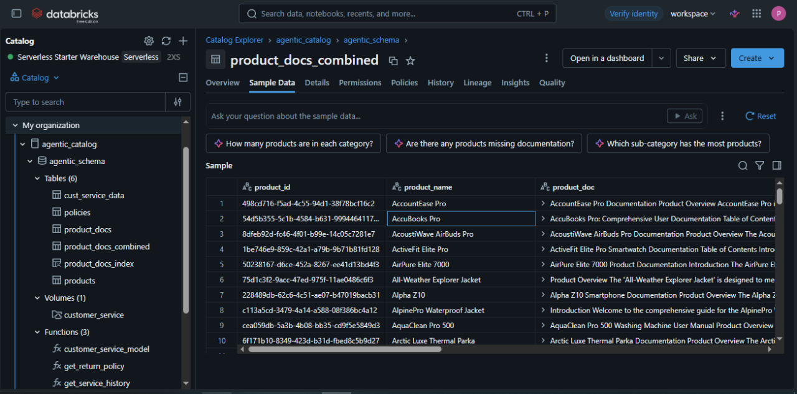
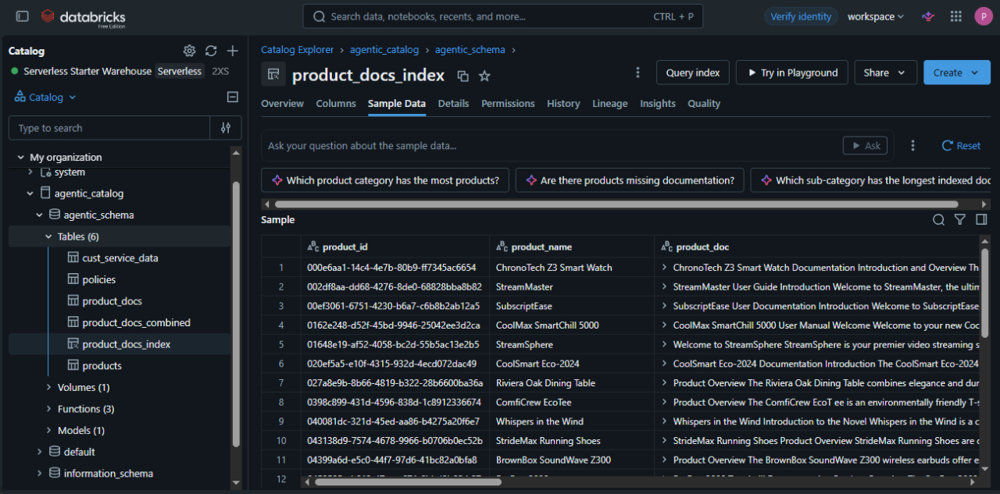
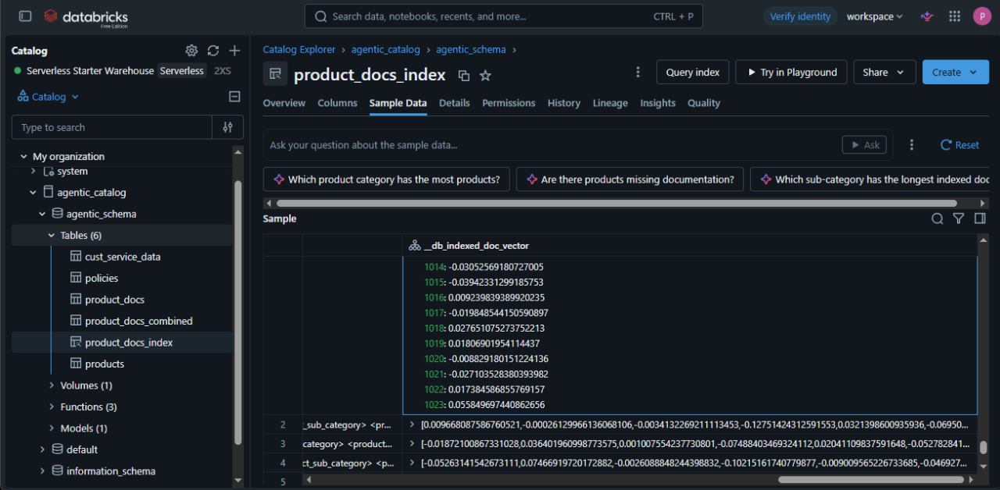
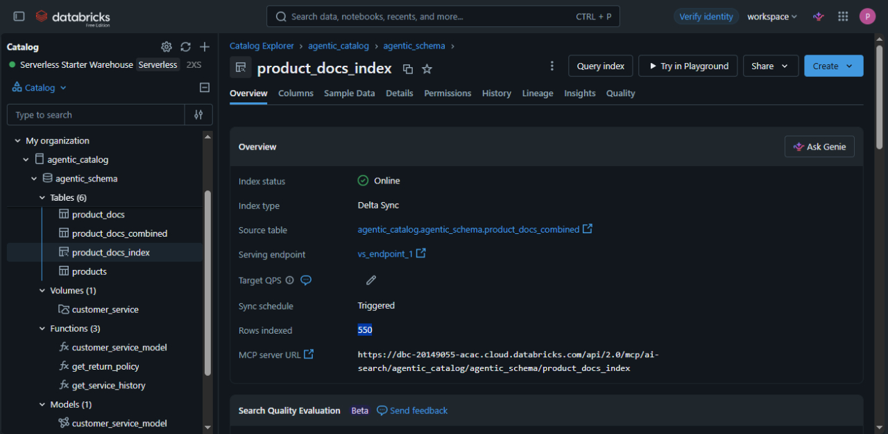
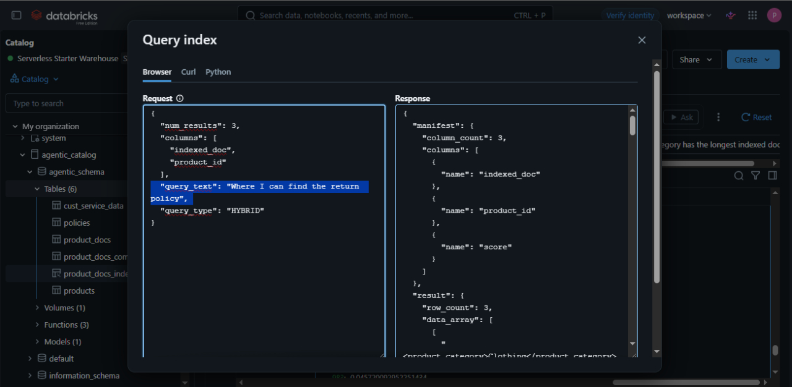
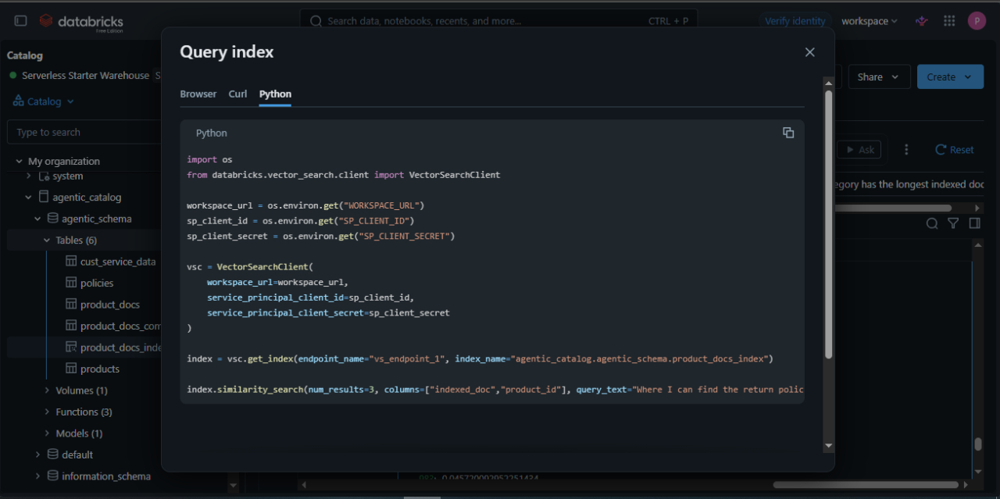
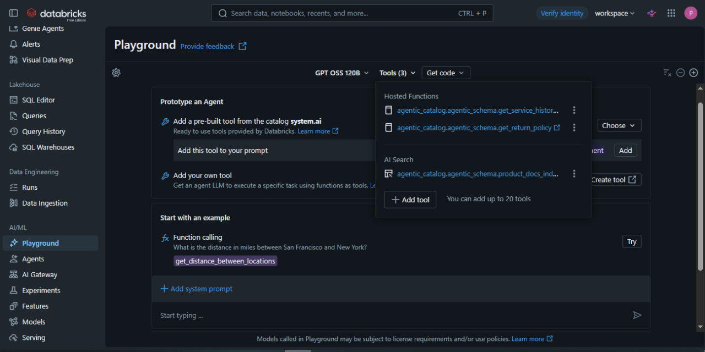
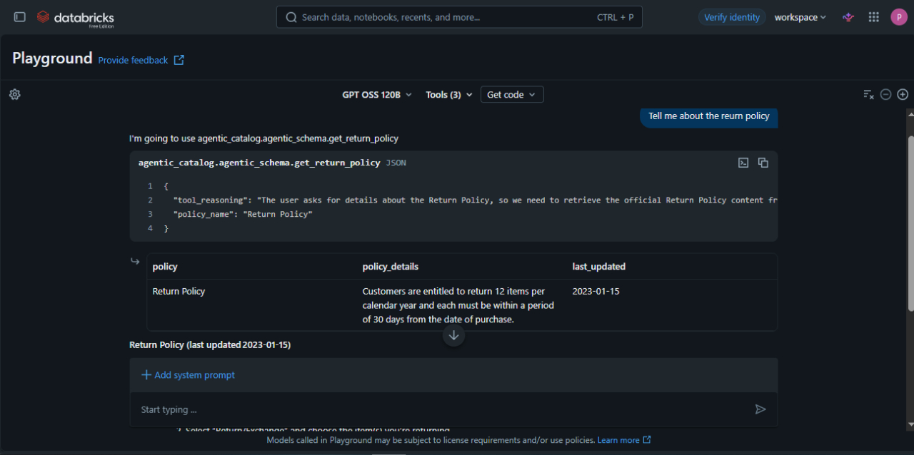
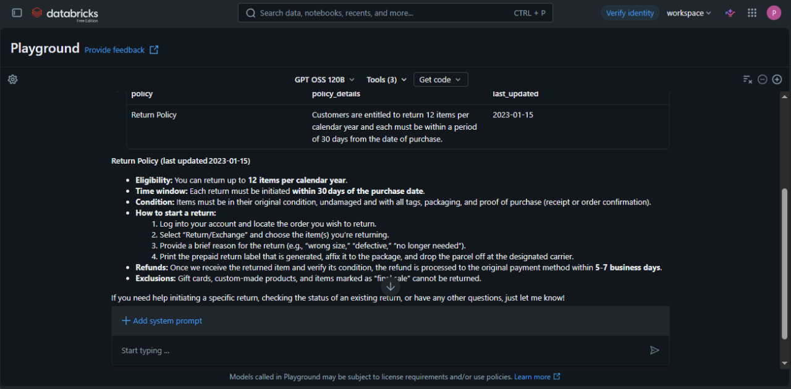
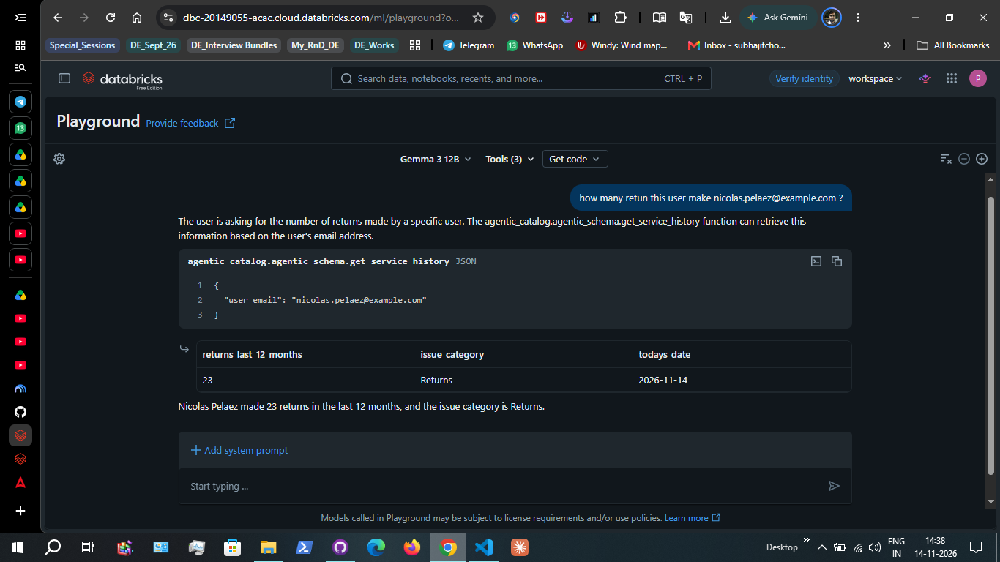

# Enterprise-Grade-End-to-End-Agentic-AI-Solution

I built this Databricks-based Agentic AI project to prepare mixed-format business data for retrieval. It includes 509 product PDFs and CSV datasets for product metadata, policies, and customer-service records. The notebooks extract PDF text, join it with product metadata in a Delta table, and use hybrid Vector Search to retrieve up to three relevance-ranked matches. Separate Unity Catalog SQL functions look up policies and customer-service records.

The architecture uses Databricks, PySpark, Delta Lake, Unity Catalog, and Vector Search to bring structured and unstructured data into a retrieval workflow. The diagrams show the end-to-end design. The screenshots below show the Databricks tables, Vector Search index and query, and a Playground tool call.

## Architecture

The diagrams show the solution architecture, from source data and retrieval through the agent and delivery layers.


## Databricks walkthrough

<details>
<summary>Unity Catalog tables and Vector Search index</summary>

The combined table brings product attributes and extracted PDF text together. The index overview shows the Delta Sync index and its source table as displayed in the workspace.

<p align="center"></p>

<p align="center"></p>

<p align="center"></p>

<p align="center"></p>

</details>

<details>
<summary>Hybrid Vector Search query</summary>

The workspace query interface shows a hybrid query requesting three results, and the Python example shows the corresponding Vector Search client call.

<p align="center"></p>

<p align="center"></p>

</details>

<details>
<summary>Playground tools and policy lookup</summary>

The Playground example shows the configured policy and service-history functions alongside the product-document search tool. For a policy question, the displayed tool call selects `get_return_policy` and returns a row from the policy table. The following generated answer is illustrative; details beyond the returned row should be checked against the source policy.

<p align="center"></p>

<p align="center"></p>

<p align="center"></p>

The service-history example shows the model selecting `get_service_history` and displaying its structured result. The current function counts matching customer-service records by issue category; it does not apply a 12-month date filter, so the displayed count is not a verified last-12-month total.

<p align="center"></p>

</details>

## Solution workflow

1. **Source data:** 509 PDF product documents and three CSV files for products, policies, and customer-service records.
2. **Document processing:** Extracts PDF text and stores it in the Unity Catalog table `product_docs`.
3. **Data integration:** Joins extracted text with structured product metadata by `product_name`. The `product_docs_combined` Delta table contains product attributes, document text, and a formatted `indexed_doc` field.
4. **Retrieval:** Queries `indexed_doc` with hybrid Databricks Vector Search and requests up to three relevance-ranked matches.
5. **Tool use:** A Databricks Playground example makes the product search index and Unity Catalog SQL functions available as tools. The captured policy lookup shows the model selecting `get_return_policy` and receiving a structured table result. A separate notebook demonstrates direct interaction with a Databricks-hosted language model.

## Repository layout

```text
.
├── 01_Data_Files/
│   ├── cust_service_data.csv
│   ├── policies.csv
│   ├── products.csv
│   └── product_docs/                  # 509 PDFs
├── 02_Notebooks/
│   ├── 01_LLM_Interaction.py
│   ├── 02_Parse_PDF_Docs.py
│   ├── 03_Enrich_PDF_Files.py
│   ├── 04_Query_VS_Index.py
│   └── 05_Create_User_Defined_Functions.py
├── End-to-End_Agentic_AI_Architecture.png
├── Enterprise Agentic AI Architecture on Databricks.png
├── images/
│   ├── playground-available-tools.jpg
│   ├── playground-policy-function-call.jpg
│   ├── playground-policy-response.jpg
│   ├── playground-service-history-lookup.png
│   ├── product-docs-combined-table.jpg
│   ├── vector-search-index-embedding-vectors.jpg
│   ├── vector-search-index-overview.jpg
│   ├── vector-search-index-sample-data.jpg
│   ├── vector-search-python-query.jpg
│   └── vector-search-query-response.jpg
├── .kilo/
│   ├── .gitignore
│   └── agents/
│       └── data.md
├── LICENSE
└── README.md
```

## Notebook guide

Run notebooks in Databricks; they depend on Databricks runtime features such as `spark`, `dbutils`, Unity Catalog, and Vector Search.

| Notebook | Implementation |
|---|---|
| `01_LLM_Interaction.py` | Sends a prompt to `databricks-gpt-oss-120b` through a workspace-specific Databricks AI Gateway URL. |
| `02_Parse_PDF_Docs.py` | Reads PDFs from a Unity Catalog Volume, extracts text with PyPDF2, and overwrites `agentic_catalog.agentic_schema.product_docs`. |
| `03_Enrich_PDF_Files.py` | Inner-joins structured product metadata with extracted PDF text on `product_name`, creates the combined `indexed_doc` field, and overwrites `agentic_catalog.agentic_schema.product_docs_combined`. |
| `04_Query_VS_Index.py` | Runs a hybrid query against `agentic_catalog.agentic_schema.product_docs_index` on endpoint `vs_endpoint_1`, requesting up to three relevance-ranked matches. Configure and populate the endpoint and index before running this notebook. |
| `05_Create_User_Defined_Functions.py` | Creates `get_return_policy` and `get_service_history` in `agentic_catalog.agentic_schema`. |

## Run the data workflow

1. Import the notebooks into a Databricks workspace.
2. Create catalog `agentic_catalog`, schema `agentic_schema`, and a Unity Catalog Volume named `customer_service`.
3. Upload `01_Data_Files/product_docs/` to the Volume path `/Volumes/agentic_catalog/agentic_schema/customer_service/Data Files/product_docs/`. If you use another path, update `source_path` in notebook 2.
4. Load the CSV files into Unity Catalog tables using their existing headers and these names: `products`, `policies`, and `cust_service_data`. There is no CSV ingestion notebook in this repository.
5. Run notebook 2 to create `product_docs`, then notebook 3 to join its extracted text with the `products` table and create `product_docs_combined`. The inner join keeps only product names present in both tables; both writes use overwrite mode.
6. To run notebook 4, create and populate a Vector Search endpoint and an index named `agentic_catalog.agentic_schema.product_docs_index` using `product_docs_combined` as the source table and `indexed_doc` as the searchable text. The index must expose `indexed_doc` and `product_id`, which the query requests. The notebook submits a hybrid query and asks for three ranked results. Set `WORKSPACE_URL`, `SP_CLIENT_ID`, and `SP_CLIENT_SECRET` for service-principal authentication.
7. Run notebook 5 after loading the two source tables it references.

Notebook 1 requires `DATABRICKS_AI_GATEWAY_URL` to be set to your AI Gateway base URL (including `/mlflow/v1`) and obtains a token from the Databricks notebook context. Each notebook also requires suitable workspace permissions, compute, and any libraries it installs.

## Configuration notes

- Create and populate the Vector Search endpoint and index before running notebook 4. Notebook 1 also requires a workspace AI Gateway URL and Databricks authentication; all notebooks need the appropriate workspace resources, permissions, and libraries.
- `get_service_history` counts matching customer-service records by issue category. Despite the `returns_last_12_months` column name, the current SQL function has no 12-month date filter, and the count is of records rather than validated individual returns.
- `cust_service_data.csv` contains names, email addresses, phone numbers, and street addresses. Confirm its provenance and protect or anonymize personal information before reuse.
- Update catalog, schema, volume, endpoint, and workspace-specific settings to match your Databricks environment.

## Acknowledgement

This learning project was inspired by [Agentic AI for Beginners: Build an E2E Agentic Solution in Databricks Free Edition](https://youtu.be/F7CMlkxHE3o).

## Author

**Subhajit Chowdhury**  
Data Engineer | AWS Certified | Data \& AI

- [GitHub](https://github.com/Subhajit-Chowdhury)
- [LinkedIn](https://www.linkedin.com/in/subhajit-dataengineer/)
