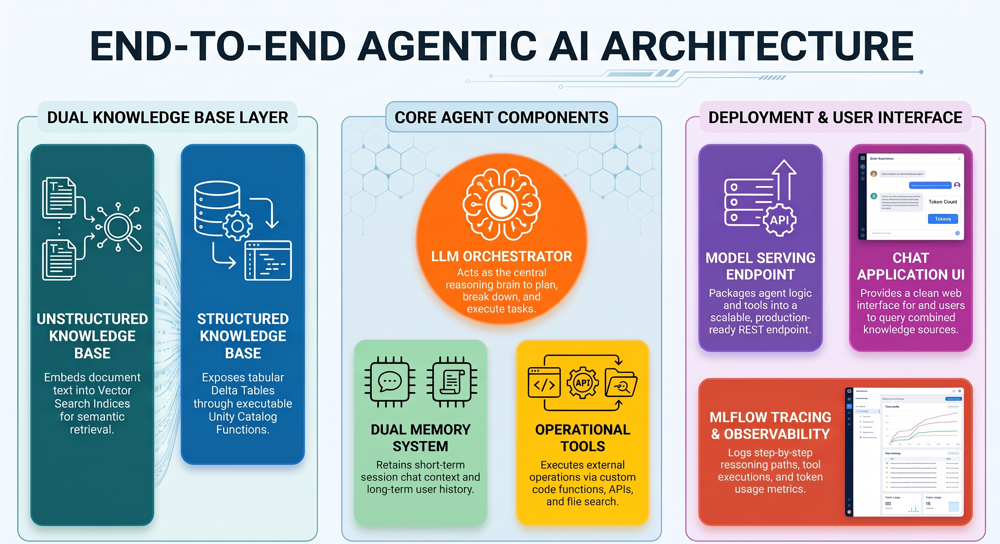

# Enterprise-Grade-End-to-End-Agentic-AI-Solution

This project explores an end-to-end Agentic AI solution on Databricks, with a data engineering workflow for preparing product documents and structured customer data for retrieval. The notebooks demonstrate PDF text extraction, PySpark transformations, Delta tables in Unity Catalog, SQL table functions, direct model interaction, and querying Databricks Vector Search.

The repository name describes the intended scope, not a production-readiness claim. This is a learning project: the diagrams show a broader target architecture, while the repository implements selected data and retrieval components. It does not include a complete agent, deployment, or chat application.

## What is implemented

- Includes 509 product-document PDFs and three CSV files: product metadata, policies, and customer-service records.
- Extracts PDF text into a Unity Catalog table, then combines that unstructured text with structured product metadata using a PySpark inner join. The resulting `product_docs_combined` Delta table contains product fields, document text, and an `indexed_doc` field formatted for retrieval.
- Queries an already-created Databricks Vector Search index over `indexed_doc` with hybrid search, requesting up to three matches. Vector Search returns matches ranked by relevance; this notebook does not create or populate the index.
- Defines Unity Catalog SQL functions to look up policy details and group customer-service records by issue category. These structured-data functions are separate from the product-document table.
- Demonstrates direct interaction with a Databricks-hosted language model.

The code does not benchmark throughput, scalability, reliability, or cost. Those properties depend on workspace configuration and have not been established by this project.

## Repository layout

```text
.
├── 01_Data_Files/
│   ├── cust_service_data.csv
│   ├── policies.csv
│   ├── products.csv
│   └── product_docs/                  # 509 PDFs
├── 02_Notebooks/
│   ├── 01_LLM_Interaction.py
│   ├── 02_Parse_PDF_Docs.py
│   ├── 03_Enrich_PDF_Files.py
│   ├── 04_Query_VS_Index.py
│   └── 05_Create_User_Defined_Functions.py
├── End-to-End_Agentic_AI_Architecture.png
├── Enterprise Agentic AI Architecture on Databricks.png
├── .kilo/
│   ├── .gitignore
│   └── agents/
│       └── data.md
├── LICENSE
└── README.md
```

## Notebook guide

Run notebooks in Databricks; they depend on Databricks runtime features such as `spark`, `dbutils`, Unity Catalog, and Vector Search.

| Notebook | Implementation |
|---|---|
| `01_LLM_Interaction.py` | Sends a prompt to `databricks-gpt-oss-120b` through a workspace-specific Databricks AI Gateway URL. |
| `02_Parse_PDF_Docs.py` | Reads PDFs from a Unity Catalog Volume, extracts text with PyPDF2, and overwrites `agentic_catalog.agentic_schema.product_docs`. |
| `03_Enrich_PDF_Files.py` | Inner-joins structured product metadata with extracted PDF text on `product_name`, creates the combined `indexed_doc` field, and overwrites `agentic_catalog.agentic_schema.product_docs_combined`. |
| `04_Query_VS_Index.py` | Runs a hybrid query against the existing `agentic_catalog.agentic_schema.product_docs_index` index on endpoint `vs_endpoint_1`, requesting up to three relevance-ranked matches. It does not create or populate the endpoint or index. |
| `05_Create_User_Defined_Functions.py` | Creates `get_return_policy` and `get_service_history` in `agentic_catalog.agentic_schema`. |

## Run the data workflow

1. Import the notebooks into a Databricks workspace.
2. Create catalog `agentic_catalog`, schema `agentic_schema`, and a Unity Catalog Volume named `customer_service`.
3. Upload `01_Data_Files/product_docs/` to the Volume path `/Volumes/agentic_catalog/agentic_schema/customer_service/Data Files/product_docs/`. If you use another path, update `source_path` in notebook 2.
4. Load the CSV files into Unity Catalog tables using their existing headers and these names: `products`, `policies`, and `cust_service_data`. There is no CSV ingestion notebook in this repository.
5. Run notebook 2 to create `product_docs`, then notebook 3 to join its extracted text with the `products` table and create `product_docs_combined`. The inner join keeps only product names present in both tables; both writes use overwrite mode.
6. To run notebook 4, create and populate a Vector Search endpoint and an index named `agentic_catalog.agentic_schema.product_docs_index` using `product_docs_combined` as the source table and `indexed_doc` as the searchable text. The index must expose `indexed_doc` and `product_id`, which the query requests. The notebook submits a hybrid query and asks for three ranked results. Set `WORKSPACE_URL`, `SP_CLIENT_ID`, and `SP_CLIENT_SECRET` for service-principal authentication.
7. Run notebook 5 after loading the two source tables it references.

Notebook 1 requires `DATABRICKS_AI_GATEWAY_URL` to be set to your AI Gateway base URL (including `/mlflow/v1`) and obtains a token from the Databricks notebook context. Each notebook also requires suitable workspace permissions, compute, and any libraries it installs.

## Known limitations

- The notebooks do not create an agent, an embedding pipeline, a Vector Search endpoint or index, a custom agent serving endpoint, a user interface, or tracing. Notebook 1 calls a pre-existing Databricks-hosted model.
- `get_service_history` groups every matching customer record by issue category. Despite its output column name, `returns_last_12_months`, it does not filter records to the last 12 months.
- The service data CSV includes names, email addresses, phone numbers, and street addresses. Its provenance is not documented; verify the data source and remove or replace personal information before public sharing or production use.
- The notebooks contain workspace-specific names and settings. Review and adapt them before running.

## Architecture diagrams

These diagrams illustrate the broader design, not a claim that every shown component is implemented in this repository.




## Acknowledgement

This learning project was inspired by [Agentic AI for Beginners: Build an E2E Agentic Solution in Databricks Free Edition](https://youtu.be/F7CMlkxHE3o).

## Author

**Subhajit Chowdhury**  
Data Engineer | AWS Certified | Snowflake

- [GitHub](https://github.com/Subhajit-Chowdhury)
- [LinkedIn](https://www.linkedin.com/in/subhajit-dataengineer/)
